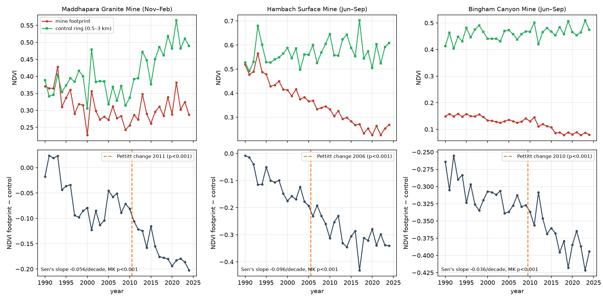

# GeoMine Analytics

[](https://github.com/Swapnil11801/geomine-analytics/actions/workflows/ci.yml)

**Is the vegetation around a mine changing because of the mine, or because the whole region is changing?**
GeoMine Analytics measures 35 years of vegetation change (Landsat, 1990–2024) at a mine footprint and compares it with
a control ring around it and with placebo sites where there is no mine.

🌍 **Demo:** https://swapnil11801.github.io/geomine-analytics/ (precomputed case studies, no setup needed) &nbsp;·&nbsp;
📄 **Paper:** [RESEARCH.md](RESEARCH.md)

<!-- RESULTS -->
## Results (1990–2024)

| Mine | Footprint − ring NDVI trend (per decade) | Placebo sites at least as extreme | Change point |
|---|---:|---:|---:|
| Maddhapara Granite Mine | -0.056 | 0 of 18 (p = 0.05) | 2011 |
| Hambach Surface Mine | -0.096 | 0 of 20 (p = 0.05) | 2006 |
| Bingham Canyon Mine | -0.036 | 0 of 14 (p = 0.07) | 2010 |

- **All three mines stand out from their placebos**, but **33 of 52 placebo sites (63%) also had a
  "significant" Mann-Kendall trend** with no mine present. A trend test's p-value alone is not evidence of mining impact.
- Harmonised Landsat and Sentinel-2 agree in pattern (pixel r = 0.87–0.98) but not in level
  (bias +0.02 to +0.09), so the series never mixes them.
- A fixed NDVI > 0.3 threshold agrees with Dynamic World poorly in settled, tree-rich land and moderately in arid land
  (κ = 0.09–0.62).


<!-- /RESULTS -->

## How it works

1. **One harmonised sensor family.** Landsat 5/7/8/9 Collection 2 surface reflectance, scaled to reflectance and
   harmonised to Landsat 8 OLI (Roy et al., 2016), cloud-masked and composited over the same months every year.
   Sentinel-2 is used only for 10 m map overlays, because mixing sensors in one series creates an artificial jump.
2. **Footprint vs control ring.** The mine outline (from OpenStreetMap) is compared with a ring 0.5–3 km around it, so
   changes shared with the surrounding landscape (weather, farming) cancel out.
3. **Trend statistics.** Mann-Kendall with the Hamed–Rao autocorrelation correction, Sen's slope and a Pettitt change point.
4. **Placebo test.** The same analysis is run on about 20 copies of the footprint moved to nearby land. The mine counts as
   unusual only if its trend is more extreme than the placebos'. This matters: most placebos show "significant" trends too.
5. **Validation.** Landsat vs Sentinel-2 agreement, and the NDVI > 0.3 vegetation threshold vs Dynamic World land cover.

The web app shows the time series, trends, change point, vegetation loss, land cover (Dynamic World), surface water (NDWI)
and NO₂ (Sentinel-5P) for any area you draw, plus a PDF report.

## Run it locally

The demo works without any setup. To analyse your own areas you need a free
[Google Earth Engine](https://earthengine.google.com/) account with a Cloud project.

```bash
git clone https://github.com/Swapnil11801/geomine-analytics.git
cd geomine-analytics

# backend (Python 3.10+)
cd server
python -m venv venv
venv\Scripts\activate            # macOS/Linux: source venv/bin/activate
pip install -r requirements.txt
earthengine authenticate         # once; opens a browser
copy .env.example .env           # macOS/Linux: cp .env.example .env, then set EE_PROJECT_ID
python -m uvicorn main:app --reload --port 8000

# frontend (Node 18+), in a second terminal
cd client
npm install
npm run dev                      # http://localhost:5173
```

Pick a case study, or draw a polygon with the tools at the top left of the map, choose the years and months, and click
**Run Analysis** (10–60 s). The top bar shows **API online** when the backend is reachable and **Demo mode** otherwise.

## Reproduce the research

```bash
pip install -r research/requirements.txt
python research/fetch_sites.py                       # mine outlines from OpenStreetMap (already committed)
python research/run_case_studies.py --project <id>   # ~1–2 h: analyses, placebos, validation, demo data
python research/make_report.py                       # regenerates RESEARCH.md from the results
pip install -r server/requirements-dev.txt && python -m pytest server/tests
```

## Repository layout

```
server/
  services/analysis.py   Earth Engine processing: harmonised Landsat, footprint vs ring, loss, NDWI, NO2, land cover
  services/stats.py      Mann-Kendall (Hamed-Rao), Sen's slope, Pettitt, accuracy metrics (no dependencies)
  tests/                 checked against pymannkendall, scipy and scikit-learn
  main.py, routers/      FastAPI endpoints
client/                  React + TypeScript + MapLibre dashboard; public/demo/ holds the precomputed case studies
research/
  sites/                 mine footprints (GeoJSON, © OpenStreetMap contributors, ODbL)
  run_case_studies.py    case studies, placebo sites, cross-sensor and threshold checks
  make_report.py         writes RESEARCH.md from results/case_studies.json
  results/, figures/     outputs
```

## Data sources

| Data | Resolution | Use |
|---|---|---|
| Landsat 5/7/8/9 Collection 2 Level-2 | 30 m | NDVI time series, vegetation loss, NDWI |
| Sentinel-2 SR (harmonised) | 10 m | map overlays from 2017; cross-sensor check |
| Dynamic World V1 | 10 m | land cover, threshold check |
| Sentinel-5P TROPOMI NO₂ (offline) | ~5 km | context only |
| OpenStreetMap | vector | mine footprints |

## Limitations

Footprints are present-day outlines; the control ring can contain spillover from the mine; about 20 placebos per site limit
the empirical p-value to about 0.05; three sites cannot support general claims; validation is against other satellite products,
not field data. See [RESEARCH.md](RESEARCH.md#6-limitations).

## Licence

MIT © 2026 Swapnil Ray. Cite with [CITATION.cff](CITATION.cff).
