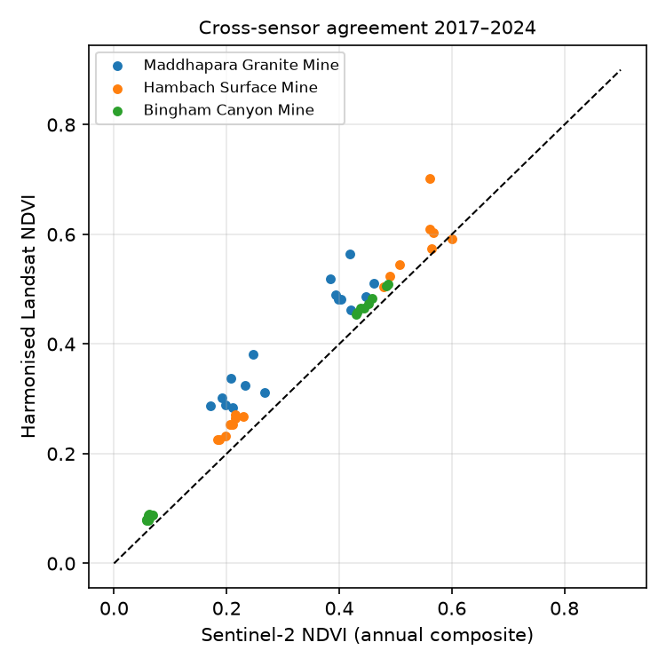

# Separating mining impact from regional change: a site-versus-control Landsat analysis of three mines, 1990–2024

**Swapnil Ray** · [source code](https://github.com/Swapnil11801/geomine-analytics) ·
[interactive demo](https://swapnil11801.github.io/geomine-analytics/) · results generated 2026-10-31

---

## Abstract

Satellite studies of mining often report a declining vegetation index near a mine as evidence of mining impact.
But vegetation also changes for reasons unrelated to mining, such as weather, farming and urban growth. We measure the
annual dry- or growing-season NDVI of three mine footprints (Maddhapara, Bangladesh; Hambach, Germany; Bingham Canyon,
USA) from 1990 to 2024 using one harmonised sensor family (Landsat 5/7/8/9), and compare each footprint with a control
ring 0.5–3 km around it. We then apply exactly the same analysis to 52 placebo sites: copies of the footprints moved
8–30 km away (copies falling on water or largely bare ground were excluded). The placebos show why this step is needed: **33 of 52
(63%) had a "significant" Mann-Kendall trend in site-minus-control NDVI** even though no mine was there,
because neighbouring landscapes rarely change in lockstep over 35 years. A p-value from a trend test is therefore not
evidence of mining impact on its own. Judged instead against the placebo distribution, the mine footprint's relative
trend was more extreme than every placebo at 3 of 3 sites (Maddhapara, Hambach, Bingham). Two validation checks complete the
picture. Harmonised Landsat and Sentinel-2 NDVI agree closely in
pattern (pixel-level r = 0.87–0.98) but differ in level (mean bias +0.02 to +0.09),
which is why the two sensors are not mixed in one series. A fixed NDVI > 0.3 vegetation threshold agrees with Dynamic World land cover
only where bare ground contrasts sharply with vegetation (Cohen's κ from 0.09 in densely settled Bangladesh
to 0.62 in semi-arid Utah).

**Keywords:** mining, NDVI, Landsat harmonisation, Mann-Kendall, placebo test, Google Earth Engine

---

## 1. Introduction

Mining directly occupies about 57,000 km² of land worldwide (Maus et al., 2020), and its indirect effects through roads,
settlements and deforestation extend much further (Sonter et al., 2017; Bebbington et al., 2018). Landsat's 40-year archive
makes it possible to follow these changes over decades (Townsend et al., 2009; Latifovic et al., 2005), and cloud platforms
such as Google Earth Engine (Gorelick et al., 2017) remove the need to download data.

Three problems recur in this kind of study:

1. **Sensor mixing.** Joining Landsat (30 m) and Sentinel-2 (10 m) series creates a step at the switch-over year, which a trend test reads as change.
2. **Attribution.** A vegetation trend at a mine may be part of a regional trend caused by climate or farming.
3. **Over-confident statistics.** Annual series are autocorrelated, and neighbouring areas diverge for many reasons, so trend tests reject "no trend" far too often.

This study addresses each one: a single harmonised Landsat series, a control ring around every footprint and, most importantly,
**placebo sites** that show how often the method reports change where no mine exists. Placebo comparisons are standard in
the causal-inference literature (Abadie et al., 2010) but rare in remote-sensing studies of mining.

## 2. Study sites

Footprints are the mapped outlines of each mine in OpenStreetMap (© OpenStreetMap contributors, ODbL), stored in
[`research/sites/`](research/sites).

| Site | Country | Type | Footprint (km²) | Composite months | Years with data |
|---|---|---|---:|---|---:|
| Maddhapara Granite Mine | Bangladesh | Underground granite mine; surface compound, processing plant and waste rock | 0.33 | Nov–Feb | 35 |
| Hambach Surface Mine | Germany | Open-pit lignite mine, expanding westwards | 47.40 | Jun–Sep | 35 |
| Bingham Canyon Mine | USA | Open-pit copper mine with waste-rock dumps | 40.52 | Jun–Sep | 35 |

Composite months were chosen per site: November–February is the dry, low-cloud season in Bangladesh, and June–September
is the growing season in Germany and Utah. "2020" for a November–February composite means November 2020 to February 2021.

## 3. Data and methods

**Imagery.** Landsat 5 TM (1990–2011), Landsat 7 ETM+ (1999–2016, gap-filling only), Landsat 8 OLI (2013–) and Landsat 9 OLI-2
(2021–) Collection 2 Level-2 surface reflectance. Digital numbers are converted to reflectance (×0.0000275 − 0.2), and TM/ETM+
reflectance is transformed to OLI equivalents with the reduced-major-axis coefficients of Roy et al. (2016). Clouds, cloud
shadow, cirrus, dilated cloud and saturated pixels are masked using the QA bands. Scenes with more than 60% cloud are skipped.
Landsat 7 is not used after 2016 because its orbit drifted to earlier overpass times.

**Composites.** For each year, the per-pixel median NDVI (Rouse et al., 1974) over the composite months is averaged over the
footprint and over the control ring. A year is used for a region only if at least 50% of its pixels are cloud-free.
Sentinel-2 is used only for the 10 m map overlays in the web app, never in the time series.

**Control ring.** The area between 0.5 and 3 km outside the footprint. The 0.5 km gap reduces edge effects. The difference
series (footprint − ring) removes changes shared by the surrounding landscape.

**Trend and change point.** Mann-Kendall test (Mann, 1945; Kendall, 1975) with the Hamed & Rao (1998) variance correction for
autocorrelation, Sen's (1968) slope computed against actual years (so missing years are handled correctly), and the Pettitt
(1979) change-point test on the difference series. Trend-free pre-whitening (Yue et al., 2002) was considered and rejected:
in our simulation test it *increased* false positives, consistent with Bayazit & Önöz (2007). The statistics are
implemented in [`server/services/stats.py`](server/services/stats.py) and tested against `pymannkendall`, `scipy` and
`scikit-learn`.

**Placebo sites.** Each footprint is copied to 20 locations on two circles around the mine (10 bearings, at distances
d and 1.75d, where d = max(8 km, 3r + 5 km) and r is the footprint's equivalent radius). Copies on open water or on more
than 30% bare ground (other mines and quarries) are skipped. The full site-versus-control analysis is repeated for each
placebo. Two quantities follow: the share of placebos with a significant difference trend (the method's empirical
false-positive rate) and an empirical p-value for the mine, p = (1 + k)/(1 + n), where k of n placebos have an absolute
difference slope at least as large as the mine's. With about 20 placebos the smallest attainable p is about 0.05.

**Vegetation loss.** Area with NDVI > 0.3 in the first year and ≤ 0.3 in the last, reported as a share of valid
pixels in the footprint and in the ring.

**Validation checks.** (i) Cross-sensor agreement: harmonised Landsat versus Sentinel-2 NDVI for 2017–2024,
as annual region means and as a 1,500-pixel random sample in 2022. (ii) Threshold agreement: NDVI > 0.3 versus
Dynamic World (Brown et al., 2022) vegetated classes (trees, grass, flooded vegetation, crops, shrub) on a 1,500-pixel
random sample in the same year. Dynamic World is itself a model output, so this measures agreement, not accuracy.

**Context indicators.** NDWI (McFeeters, 1996) and Sentinel-5P tropospheric NO₂ (Veefkind et al., 2012) are shown in
the web app for context. TROPOMI pixels are about 5 km across, so NO₂ cannot be attributed to a mine and is not analysed here.

## 4. Results

### 4.1 Trends and placebo inference

Slopes are Sen's slopes in NDVI per decade, with Mann-Kendall p-values (Hamed-Rao corrected) in brackets.

| Site | Footprint | Control ring | Footprint − ring | Placebos at least as extreme · empirical p | Pettitt change year (p) | Vegetation loss, footprint vs ring |
|---|---:|---:|---:|---:|---:|---:|
| Maddhapara Granite Mine | -0.013 (0.141) | +0.040 (0.011) | **-0.056** (<0.001) | 0 of 18 · **0.053** | 2011 (<0.001) | 55.92% vs 3.5% |
| Hambach Surface Mine | -0.087 (<0.001) | +0.018 (0.115) | **-0.096** (<0.001) | 0 of 20 · **0.048** | 2006 (<0.001) | 61.08% vs 7.65% |
| Bingham Canyon Mine | -0.024 (<0.001) | +0.010 (0.025) | **-0.036** (<0.001) | 0 of 14 · **0.067** | 2010 (<0.001) | 9.97% vs 3.42% |

*Top: annual NDVI of each footprint and its control ring. Bottom: footprint minus ring, with the Pettitt change point.*

### 4.2 How often does the method find "change" where there is no mine?

Across all 52 placebo sites, **33 (63%)** had a difference trend with Mann-Kendall p < 0.05.
- Maddhapara Granite Mine: 13 of 18 placebos significant; placebo slopes ranged from -0.045 to +0.017 per decade (mine: -0.057).
- Hambach Surface Mine: 13 of 20 placebos significant; placebo slopes ranged from -0.013 to +0.033 per decade (mine: -0.096).
- Bingham Canyon Mine: 7 of 14 placebos significant; placebo slopes ranged from -0.006 to +0.014 per decade (mine: -0.035).

The nominal 5% false-positive rate does not hold, even after the autocorrelation correction. Over 35 years, almost any two
neighbouring patches of land drift apart. The placebo distribution, not the p-value, is the right reference.

### 4.3 Cross-sensor agreement

| Site | Annual means: n, r, bias (Landsat − S2), RMSE | Pixels (2022): n, r, bias, RMSE |
|---|---|---|
| Maddhapara Granite Mine | 16, 0.94, +0.091, 0.097 | 1500, 0.87, +0.080, 0.102 |
| Hambach Surface Mine | 16, 0.98, +0.042, 0.051 | 1500, 0.97, +0.032, 0.077 |
| Bingham Canyon Mine | 16, 1.00, +0.023, 0.023 | 1500, 0.98, +0.025, 0.056 |

The sensors agree on spatial pattern but not on level. A series that switched from Landsat to Sentinel-2 in 2015–2017
would contain an artificial step of this size, comparable to or larger than the decade-scale trends in Table 4.1.

### 4.4 Agreement of the NDVI > 0.3 threshold with Dynamic World

| Site | n | Overall agreement | Cohen's κ | Non-vegetated: producer's / user's | Vegetated: producer's / user's |
|---|---:|---:|---:|---:|---:|
| Maddhapara Granite Mine | 1500 | 0.72 | 0.09 | 0.09 / 0.61 | 0.98 / 0.72 |
| Hambach Surface Mine | 1500 | 0.70 | 0.39 | 0.74 / 0.55 | 0.68 / 0.83 |
| Bingham Canyon Mine | 1500 | 0.81 | 0.62 | 0.95 / 0.67 | 0.73 / 0.96 |

Agreement was weakest at Maddhapara, where NDVI > 0.3 labelled almost all built-up village land with trees and gardens as vegetated (non-vegetated producer's agreement below 0.10), and best at Bingham Canyon, where the contrast between bare rock and scrub is sharp. A single global threshold is therefore unreliable for mapping vegetation loss in densely settled, tree-rich landscapes, and the vegetation-loss figures above should be read as indicative, with the footprint-versus-ring comparison mattering more than the absolute hectares.

## 5. Discussion

**Maddhapara Granite Mine.** The footprint's own NDVI fell in the early 1990s and has been roughly flat since, while the surrounding farmland greened significantly. The strong relative decline, more extreme than every placebo, therefore means that the mine compound did not follow its surroundings rather than that it kept losing vegetation. This fits an underground mine whose surface footprint (offices, plant, stockpiles; 89% built-up in Dynamic World) was established and then stayed developed. The 2011 change point is driven mainly by the ring greening after 2011, not by a step at the site, so it should not be read as the date of a mining event.

**Hambach Surface Mine.** This is the clearest case. Footprint NDVI fell steadily from about 0.52 in 1990 to about 0.23, while the ring showed no significant trend, and 61% of the footprint's vegetated pixels were lost compared with 8% of the ring's. The relative slope was about three times steeper than the steepest placebo. A gradual decline with a 2006 change point is consistent with an open pit advancing across the footprint over decades rather than one clearing event. Because the footprint is the present-day outline, it includes land that was still forest or farmland in 1990.

**Bingham Canyon Mine.** The footprint was already largely bare in 1990 (NDVI about 0.15), as expected for a mine operating since the early 20th century, and declined further to about 0.08 while the ring greened slightly. The relative trend was more extreme than all 14 usable placebos; 6 placebo copies were skipped: one fell on open water (the Great Salt Lake) and five on more than 30% bare ground, which is common in this semi-arid landscape. The small absolute changes show that NDVI is close to its floor here: further expansion onto bare dumps is hard to see in a vegetation index.

In all three cases the mine footprint's relative trend lay outside the placebo distribution, while most placebos would have passed a conventional significance test. The practical lesson for monitoring studies is that a site-minus-control trend with p < 0.05 is a weak criterion; it should be compared with what the same method produces at locations without a mine. With about 20 placebos the evidence is limited to p ≈ 0.05 per site, so the conclusions are that the footprint trends are unusual relative to their surroundings, not that their size has been estimated precisely or that every change inside a footprint was caused by mining.

## 6. Limitations

- **Footprints are present-day outlines.** The OSM polygons show each mine as recently mapped. Land inside them was mined at
  different times, and land mined before 1990 or outside the outline is treated as footprint or ring accordingly.
- **The ring is not a perfect control.** It can contain mine infrastructure, dust deposition or resettled villages
  (spillover), and it differs from the footprint in land use even before mining. The difference series removes shared
  change, not all confounding.
- **Few placebos.** With about 20 placebos per site, the smallest attainable empirical p is about 0.05, and placebos around
  one mine share a regional context and are not fully independent.
- **Three sites.** Three mines cannot support general claims about mine types or regulatory regimes.
- **No field data.** Validation is against other satellite products. High-resolution imagery or field surveys would be needed for accuracy assessment.
- **Landsat 7 SLC-off.** Some 2003–2016 years rely partly on striped Landsat 7 data; the coverage rule and median compositing limit, but do not remove, the effect.

## 7. Reproducibility

All code is in this repository. `python research/fetch_sites.py` downloads the footprints,
`python research/run_case_studies.py` runs every analysis through the same functions as the web API and writes
[`research/results/case_studies.json`](research/results/case_studies.json), and `python research/make_report.py`
regenerates this document. The statistics are covered by `python -m pytest server/tests`.

## References

- Abadie, A., Diamond, A., & Hainmueller, J. (2010). Synthetic control methods for comparative case studies. *Journal of the American Statistical Association*, 105(490), 493–505.
- Bayazit, M., & Önöz, B. (2007). To prewhiten or not to prewhiten in trend analysis? *Hydrological Sciences Journal*, 52(4), 611–624.
- Bebbington, A. J., Humphreys Bebbington, D., Sauls, L. A., et al. (2018). Resource extraction and infrastructure threaten forest cover and community rights. *PNAS*, 115(52), 13164–13173.
- Brown, C. F., Brumby, S. P., Guzder-Williams, B., et al. (2022). Dynamic World, near real-time global 10 m land use land cover mapping. *Scientific Data*, 9, 251.
- Gorelick, N., Hancher, M., Dixon, M., et al. (2017). Google Earth Engine: planetary-scale geospatial analysis for everyone. *Remote Sensing of Environment*, 202, 18–27.
- Hamed, K. H., & Rao, A. R. (1998). A modified Mann-Kendall trend test for autocorrelated data. *Journal of Hydrology*, 204(1–4), 182–196.
- Kendall, M. G. (1975). *Rank Correlation Methods* (4th ed.). Charles Griffin.
- Latifovic, R., Fytas, K., Chen, J., & Paraszczak, J. (2005). Assessing land cover change resulting from large surface mining development. *International Journal of Applied Earth Observation and Geoinformation*, 7(1), 29–48.
- Mann, H. B. (1945). Nonparametric tests against trend. *Econometrica*, 13(3), 245–259.
- Maus, V., Giljum, S., Gutschlhofer, J., et al. (2020). A global-scale data set of mining areas. *Scientific Data*, 7, 289.
- McFeeters, S. K. (1996). The use of the Normalized Difference Water Index (NDWI) in the delineation of open water features. *International Journal of Remote Sensing*, 17(7), 1425–1432.
- Pettitt, A. N. (1979). A non-parametric approach to the change-point problem. *Journal of the Royal Statistical Society C*, 28(2), 126–135.
- Rouse, J. W., Haas, R. H., Schell, J. A., & Deering, D. W. (1974). Monitoring vegetation systems in the Great Plains with ERTS. *Third ERTS Symposium*, NASA SP-351, 309–317.
- Roy, D. P., Kovalskyy, V., Zhang, H. K., et al. (2016). Characterization of Landsat-7 to Landsat-8 reflective wavelength and normalized difference vegetation index continuity. *Remote Sensing of Environment*, 185, 57–70.
- Sen, P. K. (1968). Estimates of the regression coefficient based on Kendall's tau. *Journal of the American Statistical Association*, 63(324), 1379–1389.
- Sonter, L. J., Herrera, D., Barrett, D. J., et al. (2017). Mining drives extensive deforestation in the Brazilian Amazon. *Nature Communications*, 8, 1013.
- Townsend, P. A., Helmers, D. P., Kingdon, C. C., et al. (2009). Changes in the extent of surface mining and reclamation in the Central Appalachians detected using a 1976–2006 Landsat time series. *Remote Sensing of Environment*, 113(1), 62–72.
- Veefkind, J. P., Aben, I., McMullan, K., et al. (2012). TROPOMI on the ESA Sentinel-5 Precursor. *Remote Sensing of Environment*, 120, 70–83.
- Yue, S., Pilon, P., Phinney, B., & Cavadias, G. (2002). The influence of autocorrelation on the ability to detect trend in hydrological series. *Hydrological Processes*, 16(9), 1807–1829.
