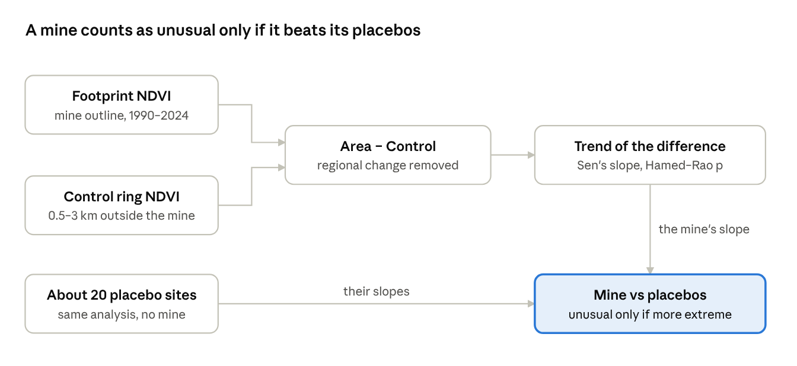

# GeoMine Analytics — User Manual

Swapnil Ray · October 2026

## What GeoMine is

GeoMine Analytics answers one question: is the vegetation around a mine changing because of the mine, or because the whole region is changing? It measures 35 years of Landsat vegetation change (1990–2024) at a mine footprint and compares it with a ring of land around the mine and with about 20 placebo sites where there is no mine.

There are two ways to use it:

| Mode | What you need | What you can do |
| --- | --- | --- |
| Live demo | A web browser | Explore three precomputed case studies: maps, time series, trends, placebo test |
| Local install | Python, Node.js and a free Google Earth Engine account | Draw any area on Earth and run a fresh analysis in 10–60 seconds |

Links: [live demo](https://swapnil11801.github.io/geomine-analytics/) · [source code](https://github.com/Swapnil11801/geomine-analytics) · [research paper (RESEARCH.md)](../RESEARCH.md)

The manual is written for three readers: a reviewer who wants to see the results in five minutes, a user who wants to analyse their own site, and a researcher who wants to check or reproduce the numbers.

## Quick start (no installation)

You can see a complete result in about a minute, with nothing installed.

1. Open [swapnil11801.github.io/geomine-analytics](https://swapnil11801.github.io/geomine-analytics/). The top bar shows **Demo mode**, which means the page is running on precomputed results.
2. In the left sidebar, under **Study Area → Pre-defined Mining Sites**, pick a site from the group **Case studies (precomputed 1990–2024)**, for example *Hambach Surface Mine*.
3. The map flies to the mine and draws its footprint (purple outline) and the control ring around it.
4. The **Statistical Summary** panel on the right fills with vegetation loss, average NDVI, NO₂, the water index, the trend tests and the placebo result.
5. Open the **Charts** panel at the bottom to see the 35-year NDVI series for the mine and the control ring.
6. In **Analysis Layers**, switch on *NDVI (start year)*, *NDVI (end year)* and *NDVI change* to see where vegetation was lost.

What to look for: the mine line falls away from the control line, the **Area − Control** chart marks the year the gap opened, and the placebo note says how many mine-free sites changed as much.

## Tour of the interface

The screen has five parts: a top bar, a sidebar on the left, the map in the middle, statistics on the right and charts at the bottom.

| Part | What it contains | Notes |
| --- | --- | --- |
| Top bar | Title, **API online** / **Demo mode** status, links to **Research** (the paper) and **Code** (GitHub) | The status turns green only when a local server is running |
| Sidebar → Study Area | Location search; **Pre-defined Mining Sites** list; status of a drawn polygon (*Custom ROI Status*, *Polygon Vertices*) | Sites under *Fly to* only move the map; you then draw an area and run it |
| Sidebar → Year Range | Start and end year; season (**Nov – Feb**, **Jun – Sep**, **Full year**) | Use the same months every year so seasons don't masquerade as trends |
| Sidebar → Analysis Layers | *Satellite*, *Study area & control ring*, *NDVI (start year)*, *NDVI (end year)*, *NDVI change*, each with an opacity slider | NDVI layers unlock after an analysis or a case study loads |
| Sidebar buttons | **Run Analysis**, **Export JSON**, **Generate PDF** | Run Analysis is greyed out in demo mode |
| Map | Satellite base map with drawing tools at the top left | Draw a polygon by clicking its corners; double-click to finish |
| Statistical Summary (right) | Vegetation Loss, Average NDVI, NO₂ Level, Water Index, NDVI trends, Land Cover | Each card has a one-line explanation under the number |
| Charts (bottom) | Tabs: **NDVI Time Series**, **Vegetation Change**, **Land Cover**, **Area − Control** | Drag the handle to resize; hover a point for exact values |

**Generate PDF** produces a report with the map, the numbers and the trend lines for the current analysis. **Export JSON** downloads the full result, which is the same format the precomputed case studies use.

## Reading the results

The single most important rule: a "significant" trend at the mine is not evidence of mining impact on its own. Judge the mine against its control ring and against the placebo sites.

### The three comparisons

1. **Footprint.** The mine outline, taken from OpenStreetMap. Its NDVI series shows everything that happened there: mining, but also drought, farming and sensor quirks.
2. **Control ring.** Land 0.5–3 km outside the footprint. It shares the footprint's weather and regional land use, so subtracting it (the **Area − Control** series) removes most regional change.
3. **Placebo sites.** About 20 copies of the footprint moved to nearby mine-free land (10 directions × 2 distances), each analysed exactly like the mine. Copies falling mostly on water or bare ground are skipped. They show how big an Area − Control trend gets by chance.



The ring removes regional change; the placebos show how large the remaining trend gets where there is no mine.

### What each number means

| Result | Where | How to read it |
| --- | --- | --- |
| Sen's slope | Trends card, Area − Control chart | NDVI change per decade; robust to outliers. Negative = losing vegetation relative to the ring |
| Mann-Kendall p | Trends card | Is there a monotonic trend? Corrected for year-to-year autocorrelation (Hamed & Rao, 1998). Necessary, not sufficient |
| Placebo count and empirical p | Placebo note | "0 of 20" means no mine-free site changed as much. Empirical p = (k + 1) / (n + 1), so 20 placebos cannot give p below about 0.05 |
| Pettitt change point | Trends card, dashed line on Area − Control | The year the mean of the difference series shifted; often matches when mining expanded |
| Vegetation Loss (ha and %) | Right panel | Area with NDVI > 0.3 in the start year but not the end year, for the footprint and for the ring |
| Average NDVI | Right panel | Mean over the series. Below 0.2 sparse, 0.2–0.4 moderate, above 0.4 dense |
| Land Cover | Right panel, Land Cover tab | Dynamic World classes for the end year (2016 or later), same months as the analysis |
| Water Index | Right panel | Mean NDWI in the end year; positive means open water dominates (pit lakes, tailings ponds) |
| NO₂ Level | Right panel | Sentinel-5P tropospheric column (2019+) over the area plus 10 km. Pixels are about 5 km wide, so this is context, not a site measurement |
| Coverage | Exported JSON (timeSeries) | Share of cloud-free pixels in that year's composite. Years under 50% are left out |

### How not to over-interpret

- In our tests, 33 of 52 placebo sites (63%) had a "significant" Mann-Kendall trend with no mine present. A p-value alone proves nothing.
- The footprint is today's outline. Earlier years include land that was not yet mined, which is exactly why the series declines.
- The control ring can contain mine spillover (dust, roads, dumps), which shrinks the measured difference.
- NDVI measures greenness, not ecosystem health, water quality or air pollution.

## The three case studies

All three mines lost vegetation relative to their surroundings faster than any of their placebo sites, but each for a different reason. The three were chosen to span climates and mine types: humid farmland, temperate forest and semi-arid scrub.

| Mine | Country, type | Footprint | Season | Area − Control slope (NDVI per decade) | Placebos at least as extreme | Change point | Vegetation loss, footprint vs ring |
| --- | --- | --- | --- | --- | --- | --- | --- |
| Hambach | Germany, open-pit lignite | 47.4 km² | Jun – Sep | −0.096 | 0 of 20 (p = 0.048) | 2006 | 61% vs 8% |
| Maddhapara | Bangladesh, underground granite | 0.33 km² | Nov – Feb | −0.056 | 0 of 18 (p = 0.053) | 2011 | 56% vs 4% |
| Bingham Canyon | USA, open-pit copper | 40.5 km² | Jun – Sep | −0.036 | 0 of 14 (p = 0.067) | 2010 | 10% vs 3% |

- **Hambach** is the clearest case. Footprint NDVI fell from about 0.52 in 1990 to about 0.23 while the ring showed no significant trend, a pattern consistent with an open pit advancing across the land over decades.
- **Maddhapara** is a small underground mine. Its own NDVI fell in the early 1990s and then stayed flat while the surrounding farmland greened. The relative decline means the compound did not follow its surroundings; the 2011 change point comes from the ring greening, not from a mining event.
- **Bingham Canyon** was already bare in 1990 (NDVI about 0.15) and fell to about 0.08. NDVI is near its floor here, so further expansion onto bare dumps is hard to see. Six placebos were skipped: one fell on the Great Salt Lake and five on mostly bare ground.

The seasons differ on purpose: the dry season (Nov – Feb) in Bangladesh avoids monsoon cloud, and summer (Jun – Sep) elsewhere is the growing season. Full discussion is in [RESEARCH.md](../RESEARCH.md).

## Analysing your own area

To analyse a new area you run a small server on your own computer that talks to Google Earth Engine. Setup takes about 15 minutes the first time.

### What you need

- Python 3.10 or newer and Node.js 18 or newer
- A free [Google Earth Engine](https://earthengine.google.com/) account linked to a Google Cloud project (noncommercial use is free). Note the project ID.

### One-time setup

1. Download the code and install the backend:

   ```bash
   git clone https://github.com/Swapnil11801/geomine-analytics.git
   cd geomine-analytics/server
   python -m venv venv
   venv\Scripts\activate          # macOS/Linux: source venv/bin/activate
   pip install -r requirements.txt
   earthengine authenticate       # opens a browser; sign in with your Earth Engine account
   ```

2. Copy `server/.env.example` to `server/.env` and set `EE_PROJECT_ID` to your Cloud project ID.
3. Install the frontend: `cd ../client` then `npm install`.

### Every time

1. Terminal 1, in `server`: activate the venv, then `python -m uvicorn main:app --reload --port 8000`.
2. Terminal 2, in `client`: `npm run dev`, then open http://localhost:5173.
3. The top bar should say **API online**. If it says **Demo mode**, the server is not reachable (see Troubleshooting).

### Running an analysis

1. Find your area with the search box or the *Fly to* list.
2. Click **Draw polygon** at the top left of the map. Click to add corners; double-click to finish. Draw the area you suspect has changed, for example a pit and its dumps, not a whole district.
3. In **Year Range**, choose start and end years (1990 or later works best) and a season. Pick the season with the least cloud and the most stable vegetation for that climate.
4. Click **Run Analysis**. It takes 10–60 seconds; large areas and long ranges take longer.
5. Read the results as described above. A fresh analysis shows the footprint, ring and trend tests; the placebo test is run only by the research scripts, because 20 extra analyses take several minutes.
6. Save with **Generate PDF** or **Export JSON**.

Tips: areas under about 0.1 km² contain only a few dozen 30 m pixels and give noisy series. Very large areas (over a few hundred km²) can hit Earth Engine time limits.

## Reproducing the research

Every number in the paper and the README is generated by scripts from the raw satellite data; nothing is typed by hand.

| Step | Command | Time | Output |
| --- | --- | --- | --- |
| 1. Install | `pip install -r research/requirements.txt` | 2 min | |
| 2. Mine outlines | `python research/fetch_sites.py` | 1 min | `research/sites/*.geojson` (already committed) |
| 3. Analyses | `python research/run_case_studies.py --project <your-ee-project>` | 1–2 h | `research/results/case_studies.json`, figures, demo data in `client/public/demo/` |
| 4. Paper | `python research/make_report.py` | seconds | `RESEARCH.md` and the README results block |
| 5. Tests | `pip install -r server/requirements-dev.txt` then `python -m pytest server/tests` | seconds | 85 tests pass |

Step 3 accepts `--only hambach` (or `maddhapara`, `bingham-canyon`) to rerun a single site. The written interpretation of each site lives in `research/interpretation.json`; `make_report.py` merges it with the computed numbers.

The statistics code is checked against independent libraries: Mann-Kendall and Sen's slope against pymannkendall, the normal distribution against SciPy, Pettitt against its textbook definition, and accuracy metrics against scikit-learn. GitHub Actions reruns the tests and rebuilds the demo on every push.

## Methods in brief

The time series uses one harmonised sensor family (Landsat) so that a change of satellite never looks like a change on the ground.

### Data

| Data | Resolution | Years | Used for |
| --- | --- | --- | --- |
| Landsat 5, 7, 8, 9 Collection 2 Level-2 surface reflectance | 30 m | 1984–present | NDVI series, vegetation loss, NDWI |
| Sentinel-2 surface reflectance (harmonised) | 10 m | 2017–present | Sharper map overlays; cross-sensor check only |
| Dynamic World V1 | 10 m | 2016–present | Land cover; check of the NDVI > 0.3 threshold |
| Sentinel-5P TROPOMI NO₂ (offline) | about 5 km | 2019–present | Context only |
| OpenStreetMap | vector | current | Mine footprints |

### Processing steps

1. **Scale.** Landsat Collection 2 values are converted to reflectance (value × 0.0000275 − 0.2).
2. **Mask.** Cloud, cloud shadow, snow and saturated pixels are removed using the QA_PIXEL and QA_RADSAT bands.
3. **Harmonise.** Landsat 5 and 7 are adjusted to match Landsat 8 using the published Roy et al. (2016) coefficients. Landsat 7 (1999–2016) only fills gaps, because a 2003 scan-line fault left stripes in its images.
4. **Composite.** For each year, the median of all clear images in the chosen months. Nov – Feb crosses the year boundary: "2020" means Nov 2020 to Feb 2021.
5. **Summarise.** Mean NDVI over the footprint and over the ring. A year is kept only if at least 50% of the region's pixels are cloud-free.
6. **Test.** Mann-Kendall trend test with the Hamed & Rao (1998) autocorrelation correction, Sen's slope using actual years (gaps allowed), and the Pettitt change-point test on the Area − Control series.
7. **Compare with placebos.** Empirical p = (number of placebos at least as extreme + 1) / (number of placebos + 1).

### Validation

- **Landsat vs Sentinel-2:** pixel correlation r = 0.87–0.98 but Landsat reads 0.02–0.09 NDVI higher, which is why the two are never mixed in one series.
- **NDVI > 0.3 vs Dynamic World:** agreement (Cohen's κ) 0.09 at Maddhapara, 0.39 at Hambach, 0.62 at Bingham Canyon. A single threshold works in arid land but poorly in tree-rich villages, so the hectare figures are indicative.

## Limitations, troubleshooting and FAQ

### Limitations

- Footprints are present-day outlines, so early years include land not yet mined.
- The control ring may contain mine spillover (dust, haul roads, dumps).
- About 20 placebos per site limit the empirical p-value to about 0.05.
- Three sites show the method works; they cannot support general claims about mining.
- Validation is against other satellite products, not field data.

### Troubleshooting

| Symptom | Cause | Fix |
| --- | --- | --- |
| Top bar says **Demo mode** locally | Server not running or on another port | Start uvicorn on port 8000 and reload the page |
| **Run Analysis** is greyed out | No server, or no polygon drawn | Start the server; draw a polygon first |
| Server error 403 or *USER_PROJECT_DENIED* | Earth Engine login expired or wrong project | Run `earthengine authenticate --force`; check `EE_PROJECT_ID` in `server/.env` |
| *Too many concurrent aggregations* | Earth Engine busy with a large area | Wait a minute and retry, or draw a smaller area; the server already retries automatically |
| Some years missing from the chart | Under 50% cloud-free pixels that year | Try a drier season, or accept the gap; Sen's slope handles missing years |
| NDVI layers stay disabled | No analysis loaded yet | Load a case study or run an analysis |

### FAQ

**Why not just compare 1990 with 2024?** Two dates can catch a wet year and a dry year. A 35-year series with a trend test is far less sensitive to one unusual year.

**Why Landsat and not Sentinel-2?** Sentinel-2 starts in 2015–2017. Landsat covers 1984 onwards; joining the two in one series creates an artificial jump.

**Can it prove a mine caused the change?** No. It shows whether the change is unusual compared with the surroundings and with mine-free land nearby. Attribution needs field evidence and mine records.

**Does it measure pollution?** Only NO₂, at about 5 km resolution, as regional context. NDVI is greenness, not contamination.

## Glossary

| Term | Meaning |
| --- | --- |
| NDVI | Normalised Difference Vegetation Index, (NIR − red) / (NIR + red). About 0 for bare rock and water, 0.2–0.4 for sparse vegetation, above 0.6 for dense forest |
| NDWI | Normalised Difference Water Index, (green − NIR) / (green + NIR). Positive over open water |
| Footprint | The mine area being studied, from OpenStreetMap |
| Control ring | Land 0.5–3 km outside the footprint, used to remove regional change |
| Area − Control | The footprint's NDVI minus the ring's, year by year |
| Placebo site | A copy of the footprint placed on nearby mine-free land and analysed the same way |
| Empirical p-value | Share of placebos at least as extreme as the mine, (k + 1) / (n + 1) |
| Mann-Kendall test | A test for a steady upward or downward trend that makes no assumption about its shape |
| Hamed & Rao correction | Adjusts Mann-Kendall for year-to-year autocorrelation, which otherwise makes trends look more significant than they are |
| Sen's slope | The median of all pairwise slopes; a trend estimate robust to outliers |
| Pettitt test | Finds the single year where the series mean shifts most |
| Composite | One image per year made from the median of all clear images in the chosen months |
| Harmonisation | Adjusting older Landsat sensors to match Landsat 8 so their values are comparable |
| Cohen's κ | Agreement between two classifications beyond chance; 0 = chance, 1 = perfect |
| Earth Engine | Google's free cloud platform for analysing satellite archives |
